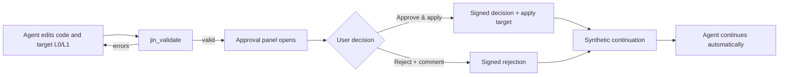

# Jin

**Architecture-driven development for OpenCode Desktop.**

Jin gives the coding agent an explicit architecture to work against. Structural
changes become reviewable proposals instead of silent edits, and a
server-enforced approval gate sits between the agent and `arch/`. Approval is
one click: the decision is signed, the target architecture is applied, and the
agent continues automatically.

This document is the user guide. For the implementation packages, see
[`packages/jin-core`](./packages/jin-core), [`packages/jin-opencode`](./packages/jin-opencode),
and [`packages/gui-extensions/src/jin`](./packages/gui-extensions/src/jin).

<p align="center">
  
</p>
<p align="center"><sub>The agent validates a proposal, Jin opens automatically, and one click applies it and resumes the agent.</sub></p>

## Why Jin

An agent can change a codebase faster than a team can update its architecture
document. When the document and the code disagree, the document stops being a
decision-making tool.

Jin makes the architecture part of the working loop:

- the architecture is stored as small, reviewable YAML files;
- agents must propose structural changes and validate them against real code;
- the user reviews a structural diff and makes one decision;
- the server records a signed decision and applies the target;
- the agent is resumed with the decision, so nobody has to repeat it.

Jin is additive to OpenCode. It does not replace the agent, the provider, or
the editor. You bring your own model; Jin supplies the architecture workflow.

## What you get

| Capability | What it does |
| --- | --- |
| **Live architecture graph** | Renders systems, layers, modules, entities, fields, methods, and direct dependency edges. Hover or select a node to trace only its relations. |
| **Structural proposals** | Every change is versioned under `arch/proposals/<REQ>/` with a target L0/L1 snapshot, rationale, acceptance criteria, and a structural diff. |
| **One-click approval** | `Approve & apply` signs the decision, applies the target, and resumes the agent. `Reject` returns the optional comment and resumes the agent too. |
| **Server-enforced gate** | The desktop is the review surface, not the security boundary. Decisions are signed with a server-owned HMAC key and bound to the reviewed target hash. |
| **Automatic continuation** | A signed decision sends a synthetic session message. The agent continues without a separate "please continue" prompt. |
| **Drift detection** | After apply, Jin compares declared entities with real declarations and reports missing or unregistered symbols. |
| **Bilingual UI** | English and Simplified Chinese, light and dark themes, responsive narrow layout. |
| **Agent tools** | Read, create, revise, inspect, validate, and (manual fallback) apply. Agents can propose, but cannot approve. |

## The development loop



1. The agent creates a proposal with `jin_proposal_create`, or revises an
   existing one with `jin_proposal_revise`.
2. The agent fills only the generated target files:
   `versions/vN/target-L0.yaml` and `versions/vN/target-L1/*.yaml`.
3. `jin_validate` checks the target against the live code. Errors go back to
   the agent; a valid target moves to `in_review`.
4. A valid validation emits an `approval` event. The desktop opens Jin in
   Review mode and selects the pending proposal.
5. The user approves or rejects once. The server signs the decision and sends a
   synthetic continuation message to the session.
6. On approval, the target architecture is applied to `arch/L0.yaml` and
   `arch/L1/`, and the proposal moves to `applied`. On rejection, only the
   decision and comment are stored.

## Quick start

### Run from source

```bash
git clone git@github.com:ZYF93/opencode-jin.git
cd opencode-jin
bun install
bun run dev:desktop
```

The desktop app is the primary Jin surface. It uses the source CLI in this
checkout, so the Jin server plugin and GUI extension are both live.

### Try it in a project

1. Open or create a project in the desktop app.
2. Open the **Architecture** side panel. It is pinned, and it is also available
   from the `Open Jin architecture` command.
3. If the project has no `arch/L0.yaml`, click **Scan current code**. Jin writes
   a draft architecture through the same scanner used by the server. It never
   overwrites an existing architecture.
4. Ask the agent for a structural change. For example:
   `Add an audit path for cancellations. Create a Jin proposal, edit only the target files, and validate it.`
5. When validation succeeds, the approval panel opens automatically. Review the
   target, the diff, and the drift warnings.
6. Click **Approve & apply** (or **Reject** with a comment). The agent resumes
   automatically.

> [!TIP]
> `jin_validate` is the handoff point. Once it succeeds the agent is told to
> wait; the user's one click is the next thing that happens.

### Build the desktop app

```bash
bun run --cwd packages/desktop build
```

The built renderer lives in `packages/desktop/out`. Jin does not bundle model
credentials; connect a provider in OpenCode as usual.

## The approval contract

Jin separates **proposal authority** from **decision authority**:

- An agent may create a proposal, edit its target files, and validate it.
- An agent may not approve. `jin_validate` only marks a valid target
  `in_review` and requests a decision.
- A human decision is written by the server's `resolve` RPC. It is signed and
  bound to the hash of the target the user reviewed.
- Approval applies the target only if the signature verifies, the target hash
  still matches, and the proposal's base architecture still matches the live
  architecture (unless an explicit force path is used).
- Rejection stores the comment and does not touch `arch/`.

<p align="center">
  
</p>
<p align="center"><sub>A rejection carries the review comment back to the agent; the agent resumes and revises without another prompt.</sub></p>

Editing `meta.yaml` or `decisions/*.yaml` by hand does not approve a proposal.
The server verifies the signature and the target hash before applying.

The signing key is resolved in this order:

1. `JIN_APPROVAL_SECRET` (recommended for shared or ephemeral environments);
2. `JIN_APPROVAL_KEY_FILE`;
3. `$XDG_DATA_HOME/opencode/jin/approval.key`, falling back to
   `~/.local/share/opencode/jin/approval.key`.

A generated key file is created with mode `0600`. Keep the secret stable across
restarts if you want previously signed decisions to remain verifiable.

### If continuation fails

The decision is durable even if the session cannot be resumed. The panel reports
that the decision was saved but the session did not continue; sending a normal
message is enough to let the agent pick it up. This can happen when the session
was closed or the server restarted between review and decision.

## Architecture model

Jin keeps two levels of architecture:

```text
arch/
  L0.yaml                 # project, systems, packages, modules, layers, externals, constraints
  L1/
    <module>.yaml         # entities, locations, fields, methods, relations
  proposals/
    <REQ>/
      meta.yaml
      versions/vN/
        target-L0.yaml
        target-L1/<module>.yaml
        summary.yaml
      decisions/vN.yaml
  history/<REQ>.yaml
```

`L0` answers "what are the parts and how are they allowed to depend on each
other?" `L1` answers "what does each module expose, where does it live, and what
does it use?"

A small L0 example:

```yaml
version: 1
project:
  name: shop
  languages: [typescript]
modules:
  - id: mod-orders
    name: orders
    package: pkg-src
    path: src/orders
    public_entities: [fn-cancel-order]
```

A matching L1 example:

```yaml
version: 1
module: mod-orders
entities:
  - id: fn-cancel-order
    kind: function
    name: cancelOrder
    location:
      file: src/orders.ts
      symbol: cancelOrder
    relations:
      - type: uses
        target: fn-order-total
```

Entity IDs are stable references used by the graph, the diff, and drift
detection. Locations must point at a real declaration for validation to pass.

## Review UI

### Review mode

- Project status, module/entity/proposal counts, and validation summary.
- Post-apply drift: missing locations and symbols are errors; unregistered
  symbols and out-of-module locations are warnings; planned entities that
  already exist are informational.
- Proposal queue with status and latest version.
- Version selection and structural diff (modules, entities, and changed files).
- Amber approval card with one-click **Approve & apply** and **Reject**, plus an
  optional comment.
- Applied history.

A pending proposal is selected automatically. The header shows an
**Approval needed** badge for proposals in `in_review`.

### Architecture mode

<p align="center">
  
</p>
<p align="center"><sub>Graph fixture: a proposal diff, direct dependency edges, and the entity inspector.</sub></p>

- Systems and layers are the outer structure; modules wrap across responsive
  columns; entity cards show fields and methods inline.
- Cross-layer module dependencies are blue dashed; cross-layer entity
  dependencies are cyan solid. Edges connect the actual cards rather than a
  side bus.
- Hover or select a node to trace only its direct relations. Unrelated systems,
  modules, cards, and edges fade out.
- Diff styling: added nodes are green with `+`, removed nodes are red dashed
  with `−`, changed nodes are amber with `~`, and moved nodes are purple with
  `›`.
- Selecting an entity opens the full fields, methods, and relations inspector
  in the right-hand column.
- `Expand all` / `Collapse all` control the current view.
- Selecting a proposal renders its target snapshot with diff styling against
  the base; selecting the current architecture renders the live snapshot.

The panel is available in English and Simplified Chinese and works in light and
dark themes.

## Agent tools

| Tool | Purpose |
| --- | --- |
| `jin_arch_read` | Read the current L0/L1 snapshot and validation summary. |
| `jin_status` | Show root, counts, proposals, decisions, and validation. |
| `jin_proposal_create` | Create a proposal and return the only target files the agent should edit. |
| `jin_proposal_revise` | Create the next version from the previous target or the current architecture. |
| `jin_proposal_read` | Inspect a proposal target, metadata, decision, and diff as JSON. |
| `jin_validate` | Validate the target; a valid target requests approval and opens the panel. |
| `jin_apply` | Manual fallback for an already approved proposal. The normal flow does not use it. |

The normal instruction is simple: **validate, then wait for the user's
decision**. Approval applies the architecture and resumes the agent.

## Languages and drift

Jin's scanner and drift adapters support:

| Language | What is extracted |
| --- | --- |
| TypeScript / JavaScript | Exported declarations, classes, types, functions, component/page/store entities, fields, methods, and usage relations. |
| Python | Top-level classes and functions, method signatures, fields, and dotted imports. |
| Java | Top-level types. |
| Kotlin | Top-level types and functions. |

The adapters are declaration-level and intentionally approximate. They are not
a compiler or a full type checker. The mixed-language fixture and parity oracle
keep the bootstrap result stable; missing locations and symbols are validation
errors, while unregistered public symbols are warnings.

## Security

- Jin ships no model credentials and no Python/CPython sidecar. Models are
  supplied by the user through OpenCode.
- The approval secret is server-owned. The desktop only sends the decision and
  the target hash it reviewed.
- Decisions are bound to the target hash. If the target changes after review,
  the server refuses to apply it.
- The approval gate protects `arch/` from accidental or forged changes. It does
  not replace code review, tests, or provider-side access controls.
- Keep `JIN_APPROVAL_SECRET` or the key file out of the repository.

## Development

```bash
bun install

# Desktop app from source
bun run dev:desktop

# Focused Jin checks
bun run --cwd packages/jin-core test
bun run --cwd packages/jin-opencode test
bun run --cwd packages/core test test/jin-plugin.test.ts
bun run --cwd packages/gui-extensions test src/jin/graph.test.ts

# Full verification from the repository root
bun run check
bun run lint:changed
```

`bun run check` is the canonical full lint and type-check verification. Tests
must run from package directories, not from the repository root.

### Manual Electron smoke test (Linux)

This uses the source CLI, an isolated test root, and the built renderer, so it
does not touch the normal server or provider credentials:

```bash
bun run --cwd packages/desktop build
cd packages/desktop

OPENCODE_CHANNEL=local \
OPENCODE_VERSION=2.0.0-local-desktop \
OPENCODE_DESKTOP_CLI_DEV=$PWD/../cli \
OPENCODE_DESKTOP_ISOLATED_SERVER=1 \
OPENCODE_DESKTOP_SERVER_CHANNEL=local \
OPENCODE_DESKTOP_TEST_ROOT=/tmp/opencode/jin-desktop-smoke \
JIN_APPROVAL_SECRET=jin-smoke \
./node_modules/.bin/electron . --no-sandbox
```

If a previous dev server is still holding port `3084` or `9222`, stop it and
remove stale `SingletonLock` files in the test root before relaunching.

### Storybook

The graph fixture is available without the desktop shell:

```bash
bun run dev:storybook
# Extensions / Jin / Architecture Graph Story
```

## Troubleshooting

| Symptom | What to do |
| --- | --- |
| Panel says the decision was saved but the agent did not continue | Send a normal message. The decision is durable; only the synthetic resume failed. |
| `symbol-unregistered` warning | A public symbol in code is not declared in L1. Add the entity or mark it internal. |
| `location-not-found` or `symbol-not-found` error | The declared file or symbol does not exist. Fix the target or the code before validating again. |
| `base_hash` mismatch on apply | The architecture changed after the proposal was created. Revise the proposal from the current architecture, or use the explicit force path if that is intentional. |
| `approval signature invalid` | The signing key changed. Re-approve with the current key, or keep `JIN_APPROVAL_SECRET` stable. |
| Approval panel does not open | Open the Architecture panel manually. The proposal is still pending; the event only auto-opens the panel. |
| Graph edges look faint | This is intentional in the overview. Hover or select a node to focus its direct relations. |

## Status and limitations

- Jin is desktop-first. The GUI extension is registered in this checkout; it is
  not yet a standalone downloadable Jin app.
- The scanner is declaration-level. It favors stable, reviewable structure over
  full semantic analysis.
- Drift is scanned on demand; large repositories may need caching later.
- Approval applies the architecture target. It does not run tests or prove that
  the implementation matches the intent; use your normal code review and CI for
  that.
- The normal flow is approval on the desktop. `jin_apply` remains as a manual
  fallback for already approved proposals.

## Fork and upstream

This repository is maintained as a private fork at
`git@github.com:ZYF93/opencode-jin.git`. Upstream OpenCode is
[`anomalyco/opencode`](https://github.com/anomalyco/opencode).

To sync with upstream:

```bash
git remote add upstream https://github.com/anomalyco/opencode.git
git fetch upstream
git rebase upstream/dev
bun install
bun run check
```

Jin is additive. The upstream files that change are the lockfile, the core
package and plugin registration, and the GUI extension package and
main/renderer registration. Most rebases should only conflict on those
registration lines and the lockfile; keep upstream's changes and re-add the Jin
entries.

## License

Jin follows the repository's upstream license. See [`LICENSE`](./LICENSE).
