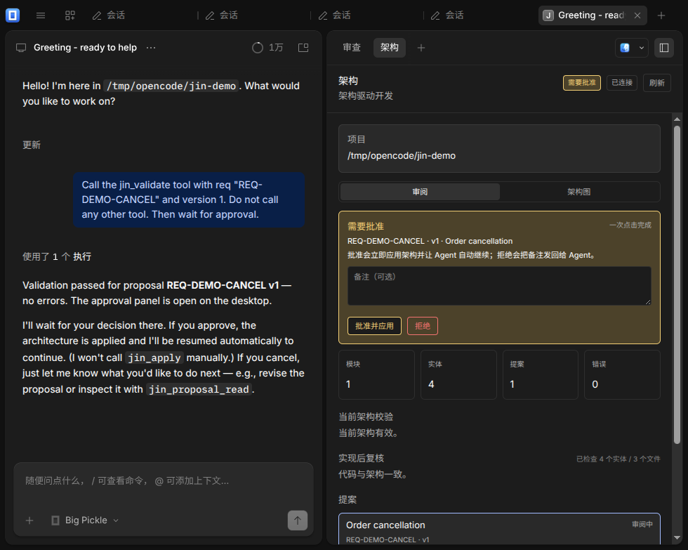
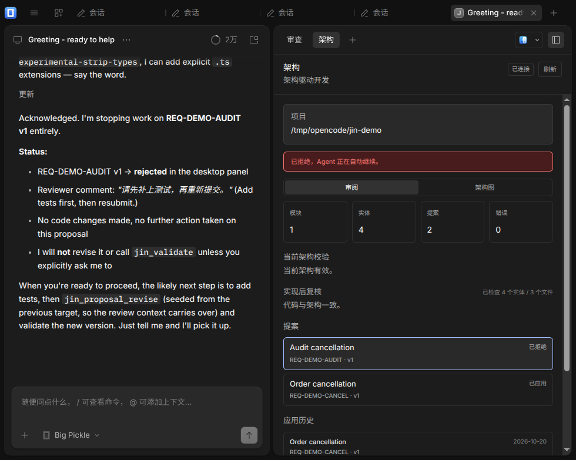
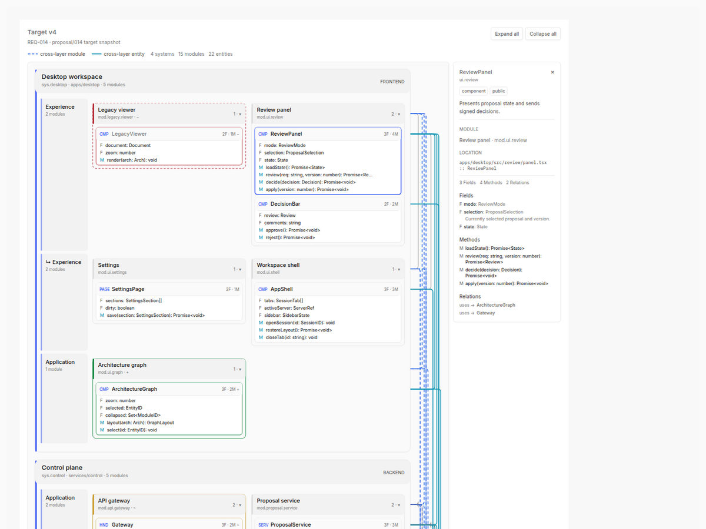

# Jin

**面向架构的 AI 开发方式，运行在 OpenCode Desktop 中。**

Jin 让 Coding Agent 在一个明确的架构约束下工作。结构性改动不再直接改代码，
而是变成可审阅的提案；Agent 与 `arch/` 之间有一道由服务器强制执行的审批门。
审批只需一次点击：服务器签名并应用目标架构，然后 Agent 自动继续。

本文是面向用户的使用指南。实现包见
[`packages/jin-core`](./packages/jin-core)、[`packages/jin-opencode`](./packages/jin-opencode)
和 [`packages/gui-extensions/src/jin`](./packages/gui-extensions/src/jin)。

<p align="center">
  
</p>
<p align="center"><sub>Agent 校验提案后，Jin 自动打开；一次点击即可应用架构并让 Agent 继续。</sub></p>

## 为什么需要 Jin

Agent 修改代码的速度，往往快过团队更新架构文档的速度。当文档和代码不一致时，
架构文档就失去了决策价值。

Jin 把架构放进日常开发闭环：

- 架构以小型、可审阅的 YAML 文件保存；
- Agent 必须提出结构性提案，并对着真实代码做校验；
- 用户查看结构化差异，只做一次决策；
- 服务器记录带签名的决策并应用目标架构；
- 决策以合成消息发回会话，Agent 自动继续，不需要用户再催一遍。

Jin 是 OpenCode 的增量能力，不替代 Agent、模型 Provider 或编辑器。模型由用户
自己提供，Jin 负责架构工作流。

## 核心能力

| 能力 | 说明 |
| --- | --- |
| **实时架构图** | 展示系统、分层、模块、实体、字段、方法和直接依赖边；悬浮或选中节点时只保留它直接相关的连线。 |
| **结构化提案** | 每个改动都保存在 `arch/proposals/<REQ>/` 下，包含目标 L0/L1 快照、理由、验收标准和结构化差异。 |
| **一键审批** | `批准并应用` 会签名、应用目标并让 Agent 继续；`拒绝` 会把可选备注发回给 Agent，同样自动继续。 |
| **服务器强制审批门** | 桌面端只是审阅界面，不是安全边界。决策由服务器持有的 HMAC 密钥签名，并绑定到审阅时的目标哈希。 |
| **自动继续** | 决策会产生一条合成会话消息，Agent 无需额外提示就会继续。 |
| **漂移检测** | 应用后，Jin 把声明的实体与真实代码声明对比，报告缺失或未登记的符号。 |
| **双语界面** | 简体中文 / English，明暗主题，窄窗口自适应。 |
| **Agent 工具** | 读取、创建、修订、查看、校验，以及手动兜底的应用。Agent 可以提提案，但不能批准。 |

## 开发闭环


1. Agent 用 `jin_proposal_create` 创建提案，或用 `jin_proposal_revise` 修订。
2. Agent 只编辑生成的目标文件：`versions/vN/target-L0.yaml` 和
   `versions/vN/target-L1/*.yaml`。
3. `jin_validate` 用真实代码校验目标。有错误就回到 Agent；通过后提案进入
   `in_review`。
4. 校验通过会发出 `approval` 事件，桌面端自动切到 Jin 的审阅模式并选中该提案。
5. 用户批准或拒绝一次。服务器签名决策，并向会话发送合成继续消息。
6. 批准后目标架构写入 `arch/L0.yaml` 和 `arch/L1/`，提案变为 `applied`；
   拒绝只保存决策和备注，不改架构。

## 快速开始

### 从源码运行

```bash
git clone git@github.com:ZYF93/opencode-jin.git
cd opencode-jin
bun install
bun run dev:desktop
```

桌面端是 Jin 的主要界面。它直接使用当前 checkout 的源码 CLI，因此 Jin 的
服务器插件和 GUI 扩展都会生效。

### 在项目里试用

1. 在桌面端打开或创建一个项目。
2. 打开侧边栏的 **架构** 面板。它是固定标签页，也可以通过
   `Open Jin architecture` 命令打开。
3. 如果项目还没有 `arch/L0.yaml`，点击 **扫描当前代码**。Jin 会用与服务器
   相同的扫描器生成草稿，不会覆盖已有架构。
4. 让 Agent 做一个结构性改动，例如：
   `为取消订单增加审计路径。创建一个 Jin 提案，只编辑目标文件，并校验。`
5. 校验通过后，审批面板会自动打开。查看目标、差异和漂移提示。
6. 点击 **批准并应用**（或带备注 **拒绝**）。Agent 会自动继续。

> [!TIP]
> `jin_validate` 是交接点。校验通过后 Agent 会停下来等待；用户的一次点击
> 就是接下来发生的事。

### 构建桌面端

```bash
bun run --cwd packages/desktop build
```

构建产物在 `packages/desktop/out`。Jin 不内置模型凭据；照常连接你的
Provider 即可。

### 打包桌面端 Release

`.github/workflows/release-desktop.yml` 会构建 macOS（Apple Silicon 和 Intel）、
Windows x64、Linux x64 的未签名安装包。推送 `v2.0.32-jin.1` 这样的 tag，或在
Actions 里手动运行并填写相同版本号，工作流会创建 GitHub Release 并附带校验和。

工作流设置 `OPENCODE_SKIP_SIGNING=true` 和 `OPENCODE_DESKTOP_UPDATER=disabled`，
因此这些社区构建不需要 Apple/Windows 签名凭据，也不会被上游 OpenCode 的自动更新
覆盖。本地 Linux 打包命令见 `packages/desktop/README.md`。

## 审批契约

Jin 把**提案权**和**决策权**分开：

- Agent 可以创建提案、编辑目标文件、执行校验。
- Agent 不能批准。`jin_validate` 只把通过校验的目标标记为 `in_review`，
  并请求用户决策。
- 人工决策由服务器的 `resolve` RPC 写入，带签名，并绑定到用户审阅的目标
  哈希。
- 只有签名有效、目标哈希仍一致、提案基线架构仍与当前架构一致时，批准才会
  应用目标（显式 force 路径除外）。
- 拒绝会保存备注，不修改 `arch/`。

<p align="center">
  
</p>
<p align="center"><sub>拒绝会把审阅备注带回给 Agent；Agent 自动继续并修订，不需要用户再发一次提示。</sub></p>

手动修改 `meta.yaml` 或 `decisions/*.yaml` 不会批准提案。服务器在应用前会
验证签名和目标哈希。

签名密钥按以下顺序解析：

1. `JIN_APPROVAL_SECRET`（共享或临时环境推荐）；
2. `JIN_APPROVAL_KEY_FILE`；
3. `$XDG_DATA_HOME/opencode/jin/approval.key`，否则
   `~/.local/share/opencode/jin/approval.key`。

自动生成的密钥文件权限为 `0600`。如果希望之前签名的决策长期可验证，请保持
密钥稳定。

### 自动继续失败时

即使会话无法恢复，决策也已经持久化。面板会提示"决策已保存，但会话未能自动
继续"，此时正常发一条消息即可让 Agent 接着处理。会话关闭或服务器在审阅与
决策之间重启时可能出现这种情况。

## 架构模型

Jin 保存两级架构：

```text
arch/
  L0.yaml                 # 项目、系统、包、模块、分层、外部依赖、约束
  L1/
    <module>.yaml         # 实体、位置、字段、方法、关系
  proposals/
    <REQ>/
      meta.yaml
      versions/vN/
        target-L0.yaml
        target-L1/<module>.yaml
        summary.yaml
      decisions/vN.yaml
  history/<REQ>.yaml
```

`L0` 回答"系统由哪些部分组成，它们允许怎样依赖？"`L1` 回答"每个模块对外
暴露什么、位于哪里、依赖什么？"

一个简短的 L0 示例：

```yaml
version: 1
project:
  name: shop
  languages: [typescript]
modules:
  - id: mod-orders
    name: orders
    package: pkg-src
    path: src/orders
    public_entities: [fn-cancel-order]
```

对应的 L1 示例：

```yaml
version: 1
module: mod-orders
entities:
  - id: fn-cancel-order
    kind: function
    name: cancelOrder
    location:
      file: src/orders.ts
      symbol: cancelOrder
    relations:
      - type: uses
        target: fn-order-total
```

实体 ID 是架构图、差异和漂移检测共同使用的稳定引用。位置必须指向真实声明，
校验才能通过。

## 审阅界面

### 审阅模式

- 项目状态、模块/实体/提案数量、校验摘要。
- 应用后漂移：缺少位置或符号是错误；未登记符号、模块外位置是警告；
  `planned` 实体已经存在是提示。
- 提案队列，显示状态和最新版本。
- 版本切换和结构化差异（模块、实体、变更文件）。
- 琥珀色审批卡：**批准并应用**、**拒绝**，以及可选备注。
- 应用历史。

有待审批提案时面板会自动选中它。`in_review` 提案会在标题栏显示
**需要批准** 徽标。

### 架构图模式

<p align="center">
  
</p>
<p align="center"><sub>架构图夹具：提案差异、直接依赖边与实体检查器。</sub></p>

- 系统和分层构成外层结构；模块最多按两列响应式排布；实体卡内联显示字段和方法。
- 跨层模块依赖是蓝色虚线，跨层实体依赖是青色实线；连线直接连接卡片，不走
  侧边总线。
- 悬浮或选中节点时，只保留它的直接关系；无关的系统、模块、卡片和连线淡出。
- 差异样式：新增节点为绿色 `+`，删除节点为红色虚线 `−`，变更节点为琥珀色
  `~`，移动节点为紫色 `›`。
- 选中实体后，右侧栏显示完整字段、方法和关系检查器。
- `全部展开` / `全部收起` 控制当前视图。
- 选择提案时显示目标快照并按基线标注差异；选择当前架构时显示实时快照。

面板支持简体中文和英文，明暗主题均可使用。

## Agent 工具

| 工具 | 用途 |
| --- | --- |
| `jin_arch_read` | 读取当前 L0/L1 快照和校验摘要。 |
| `jin_status` | 显示根目录、数量、提案、决策和校验状态。 |
| `jin_proposal_create` | 创建提案，并返回 Agent 唯一应该编辑的目标文件。 |
| `jin_proposal_revise` | 基于上一版目标或当前架构创建下一版。 |
| `jin_proposal_read` | 以 JSON 查看提案目标、元数据、决策和差异。 |
| `jin_validate` | 校验目标；通过后请求审批并打开面板。 |
| `jin_apply` | 已批准提案的手动兜底；正常流程不需要调用。 |

正常指令很简单：**校验，然后等待用户决策**。批准会应用架构并让 Agent 继续。

## 语言与漂移

Jin 的扫描器和漂移适配器支持：

| 语言 | 提取内容 |
| --- | --- |
| TypeScript / JavaScript | 导出声明的类、类型、函数、组件/页面/Store 实体、字段、方法和使用关系。 |
| Python | 顶层类和函数、方法签名、字段、点号导入。 |
| Java | 顶层类型。 |
| Kotlin | 顶层类型和函数。 |

适配器是声明级的，故意保持近似，不是编译器或完整类型检查器。混合语言夹具
和 parity oracle 用来锁定扫描结果；缺少位置或符号是校验错误，未登记的公开
符号是警告。

## 安全

- Jin 不内置模型凭据，也不带 Python/CPython sidecar。模型由用户通过 OpenCode
  提供。
- 审批密钥由服务器持有。桌面端只发送决策和它审阅过的目标哈希。
- 决策绑定目标哈希。审阅后目标若发生变化，服务器会拒绝应用。
- 审批门保护 `arch/` 免受误改或伪造，但不替代代码审阅、测试或 Provider 侧
  的访问控制。
- 不要把 `JIN_APPROVAL_SECRET` 或密钥文件提交进仓库。

## 开发

```bash
bun install

# 从源码启动桌面端
bun run dev:desktop

# Jin 聚焦检查
bun run --cwd packages/jin-core test
bun run --cwd packages/jin-opencode test
bun run --cwd packages/core test test/jin-plugin.test.ts
bun run --cwd packages/gui-extensions test src/jin/graph.test.ts

# 仓库根目录完整验证
bun run check
bun run lint:changed
```

`bun run check` 是完整的 lint 和类型检查入口。测试必须在各包目录内运行，不能
从仓库根目录运行。

### Linux Electron 手动冒烟测试

使用源码 CLI、隔离测试根目录和已构建的 renderer，不会影响正常服务器或
Provider 凭据：

```bash
bun run --cwd packages/desktop build
cd packages/desktop

OPENCODE_CHANNEL=local \
OPENCODE_VERSION=2.0.0-local-desktop \
OPENCODE_DESKTOP_CLI_DEV=$PWD/../cli \
OPENCODE_DESKTOP_ISOLATED_SERVER=1 \
OPENCODE_DESKTOP_SERVER_CHANNEL=local \
OPENCODE_DESKTOP_TEST_ROOT=/tmp/opencode/jin-desktop-smoke \
JIN_APPROVAL_SECRET=jin-smoke \
./node_modules/.bin/electron . --no-sandbox
```

如果旧的开发服务器仍占用 `3084` 或 `9222` 端口，先停止它，并删除测试根目录
里的 `SingletonLock` 再启动。

### Storybook

不启动桌面端也可以查看架构图夹具：

```bash
bun run dev:storybook
# Extensions / Jin / Architecture Graph Story
```

## 常见问题

| 现象 | 处理 |
| --- | --- |
| 面板提示决策已保存，但 Agent 没有继续 | 正常发一条消息。决策已经持久化，只是合成恢复失败。 |
| `symbol-unregistered` 警告 | 代码里有公开符号未登记到 L1。补充实体，或标记为 internal。 |
| `location-not-found` / `symbol-not-found` 错误 | 声明的文件或符号不存在。修正目标或代码后重新校验。 |
| 应用时 `base_hash` 不一致 | 提案创建后架构已变化。基于当前架构修订提案；如果确实要强制应用，再走显式 force。 |
| `approval signature invalid` | 签名密钥变了。用当前密钥重新批准，或保持 `JIN_APPROVAL_SECRET` 稳定。 |
| 审批面板没有自动打开 | 手动打开架构面板。提案仍在待审批状态，事件只负责自动打开界面。 |
| 架构图连线很淡 | 总览时刻意如此。悬浮或选中节点即可聚焦直接关系。 |

## 状态与限制

- Jin 目前以桌面端为主。GUI 扩展已在本仓库注册，但还不是独立可下载的 Jin
  应用。
- 扫描器是声明级的，优先稳定、可审阅的结构，而不是完整语义分析。
- 漂移按需扫描；超大仓库以后可能需要缓存。
- 审批应用的是架构目标，不会自动跑测试，也不能证明实现符合意图；代码审阅和
  CI 仍然必要。
- 正常流程是在桌面端一次点击批准。`jin_apply` 只作为已批准提案的手动兜底。

## 分支与上游

本仓库是私有分支：`git@github.com:ZYF93/opencode-jin.git`。上游 OpenCode 是
[`anomalyco/opencode`](https://github.com/anomalyco/opencode)。

与上游同步：

```bash
git remote add upstream https://github.com/anomalyco/opencode.git
git fetch upstream
git rebase upstream/dev
bun install
bun run check
```

Jin 是增量式的。会改到的上游文件只有 lockfile、core 包和插件注册、GUI
extension 包以及 main/renderer 注册。多数 rebase 只会在这些注册行和 lockfile
上冲突；保留上游改动，再把 Jin 的入口加回去。

## 许可证

Jin 遵循仓库上游许可证。见 [`LICENSE`](./LICENSE)。
